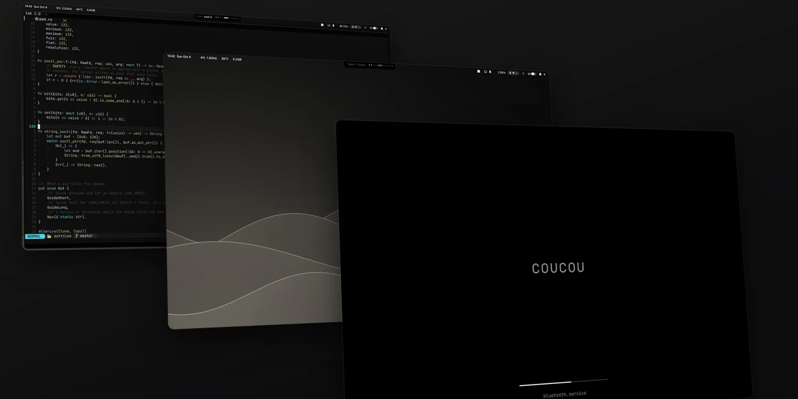
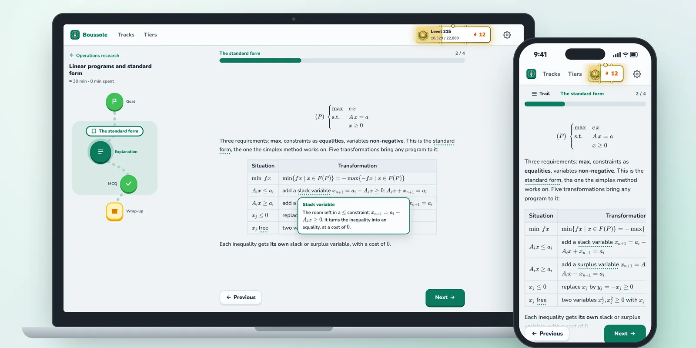

What I'm building at the moment, shared as it goes.

<!--
  One block per project. To add one: put a 2:1 image (1600×800, .webp) in assets/,
  then copy a block below. To retire one: delete its block and its image.
-->

**[coucou-shell](https://github.com/lucasssoh/dotfiles)** · a Fedora desktop on Hyprland, installed and updated like a package. 
Hyprland · Quickshell · Rust · GTK4

 

**[Boussole](https://github.com/lucasssoh/Boussole)** · turns course documents into a track to study step by step. 
Java · Spring Boot · Angular · SQLite
