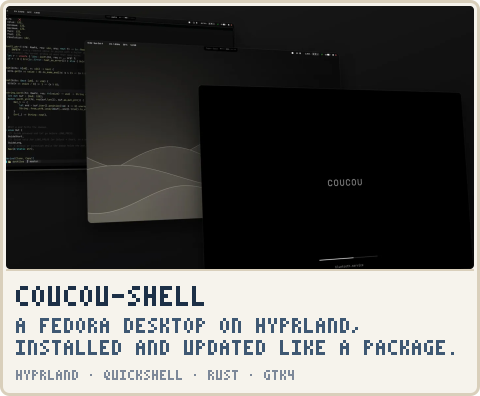
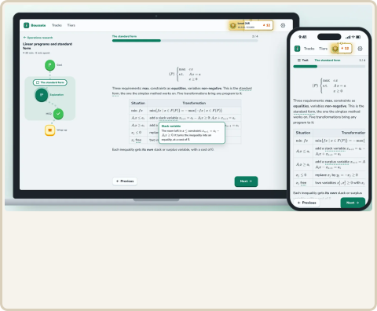
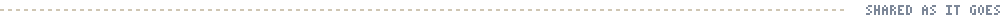

<picture>
  <source media="(prefers-color-scheme: dark)" srcset="banner/night.svg">
  
</picture>

<!-- To add a project: put a 16:9 image in assets/ and an entry in projects.json. The cards below are generated. -->
<!-- projects:start -->

<picture><source media="(prefers-color-scheme: dark)" srcset="projects/heading-night.svg"></picture>

<a href="https://github.com/lucasssoh/dotfiles"><picture><source media="(prefers-color-scheme: dark)" srcset="projects/coucou-shell-night.svg"></picture></a>&nbsp;<a href="https://github.com/lucasssoh/Boussole"><picture><source media="(prefers-color-scheme: dark)" srcset="projects/boussole-night.svg"></picture></a>

<picture><source media="(prefers-color-scheme: dark)" srcset="projects/footer-night.svg"></picture>

<!-- projects:end -->
